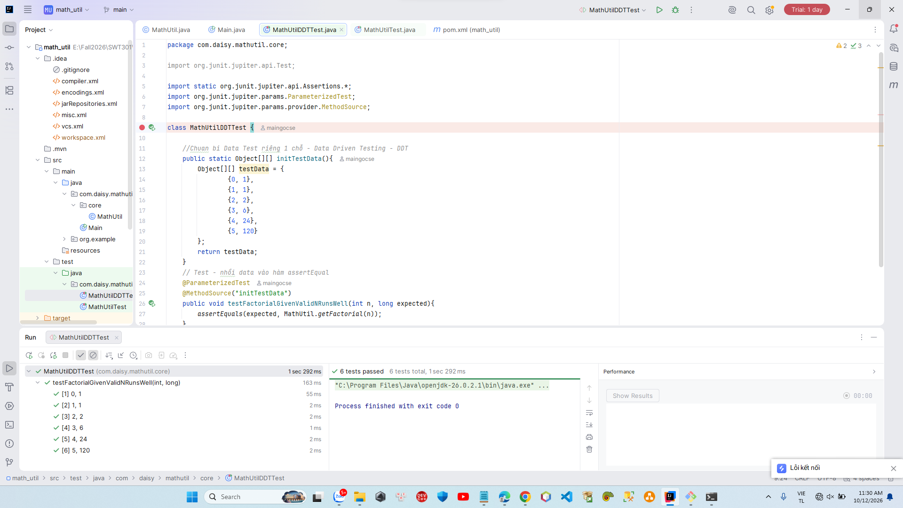

# Welcome to Math Utility

### You will find in this repo the following stuff:
* A Maven project to implement Math Util library
* A JUnit source code to demonstrate the Unit Testing, TDD and DDT technique
* A CI script to check and build the project automatically with Github actions
  

#### Connect me via: maingocse200139@gmail.com

##### &#164; 2026 - maingocse
